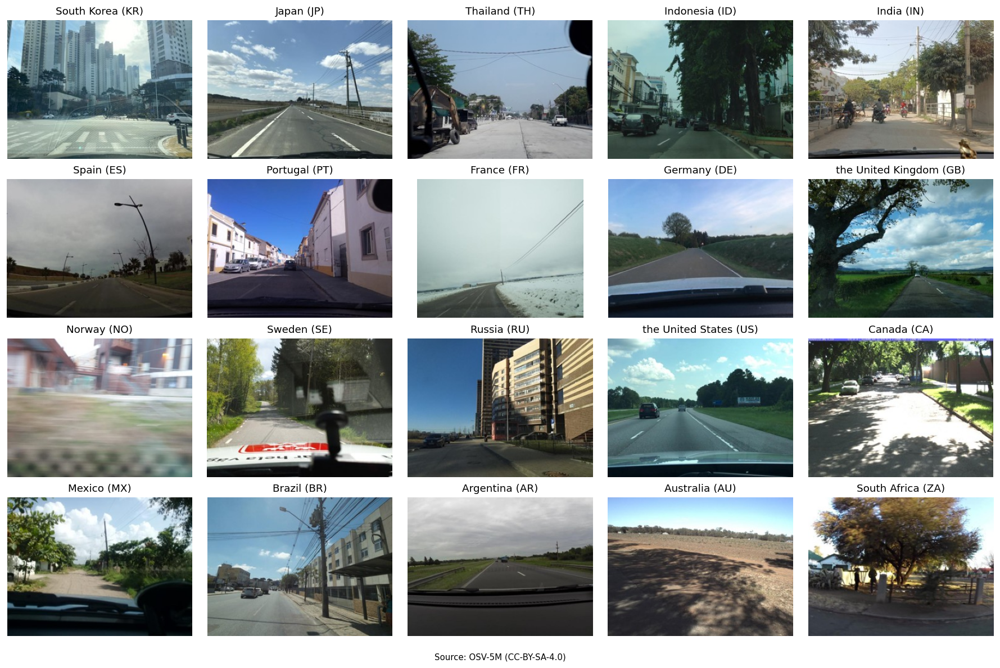
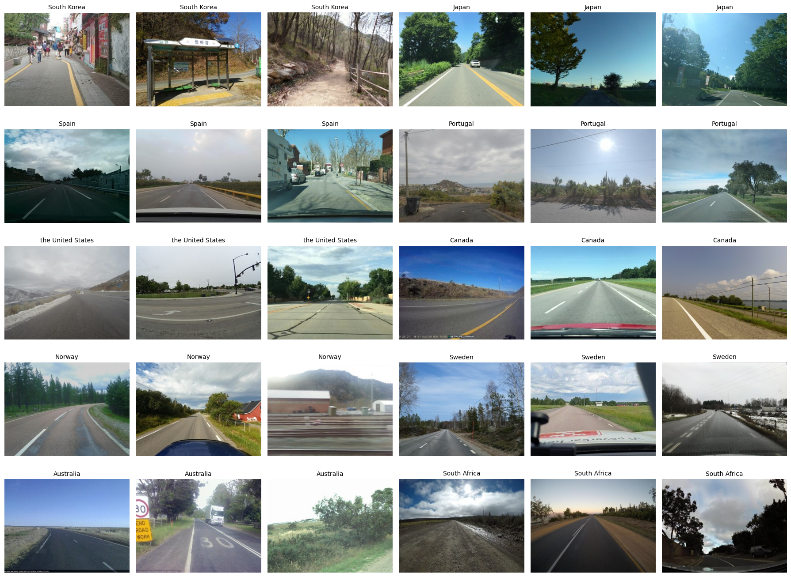
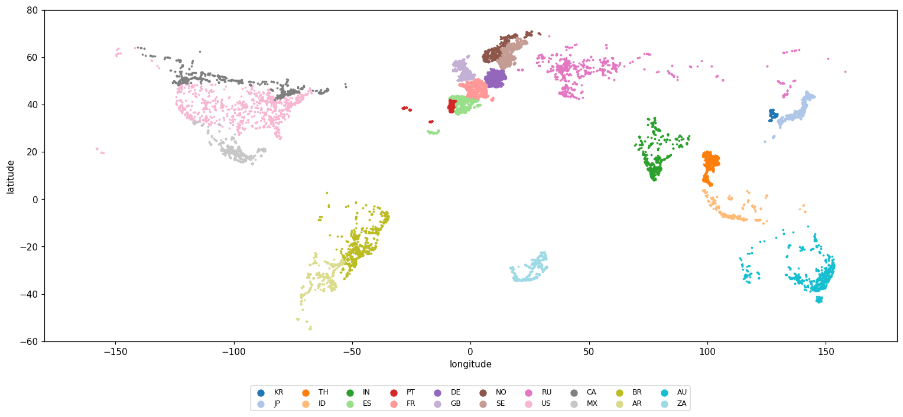
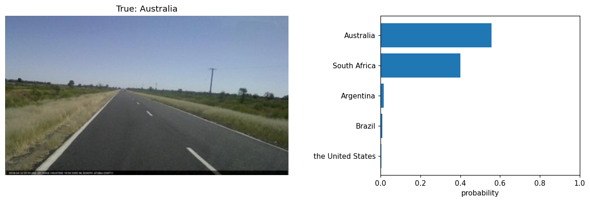
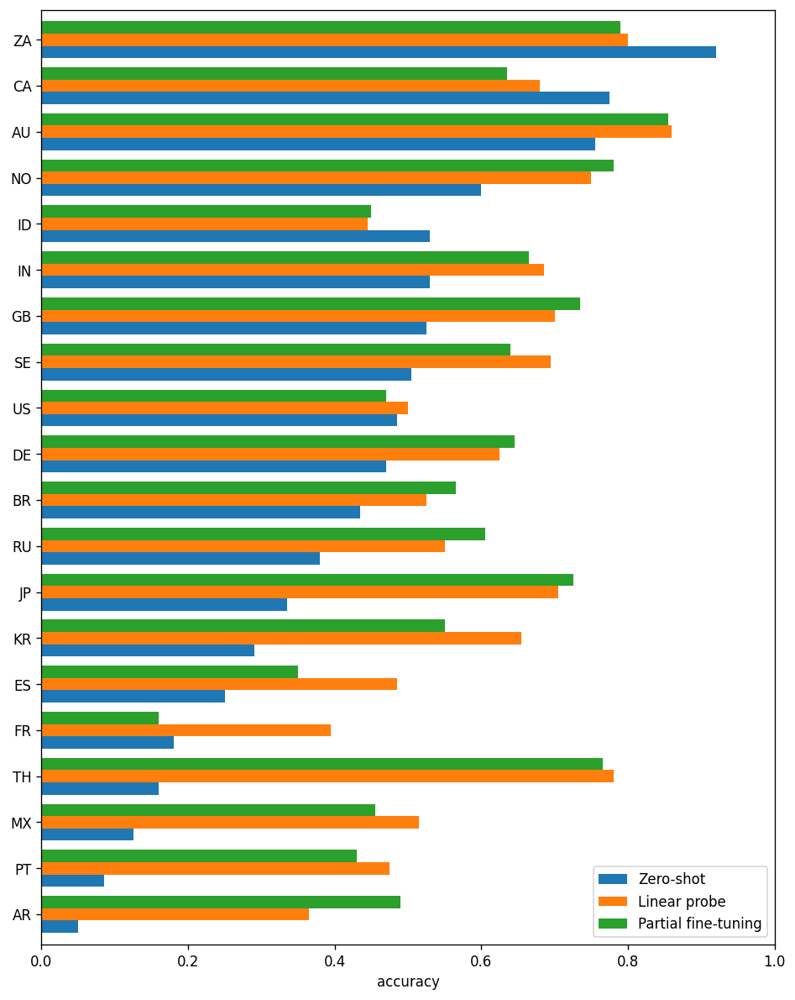
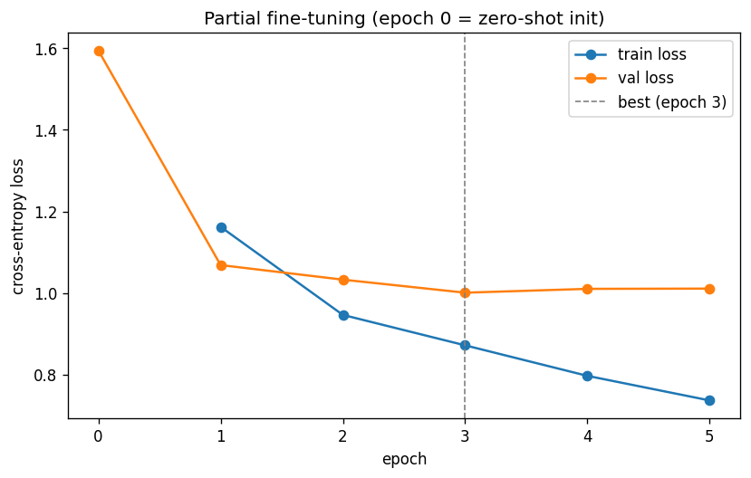
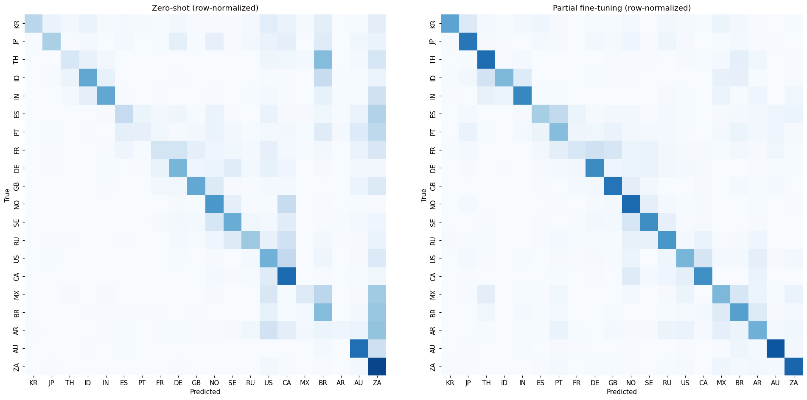
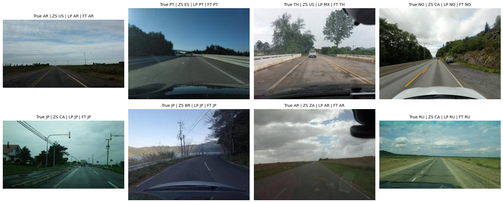
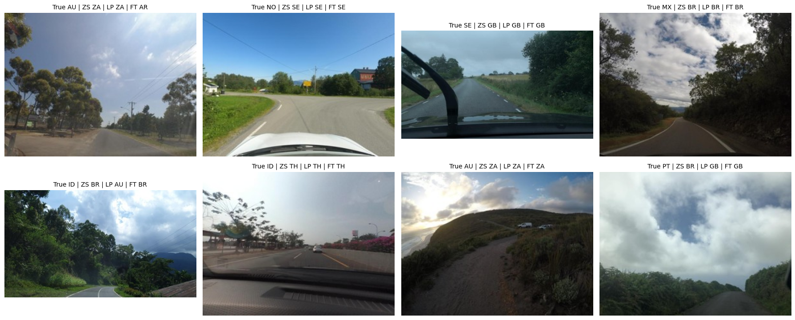

# OpenAI CLIP 모델 전이학습 단계에 따른 OSV-5M 데이터셋 거리 사진 국가 분류

**Members**

| 이름 | 학과 | 이메일 |
| --- | --- | --- |
| 이학영 | 경영학부 | cranezero1103@gmail.com |
| 장윤도 | 화학과 | zhangrt2024@yeah.net |
| 류현성 | 전자공학부 | ksi7080z@naver.com |
| 정재호 | 컴퓨터소프트웨어학부 | jaeho041005@outlook.com |

**Video**: (작성중)

## Table of Contents

- [I. Proposal](#i-proposal)
  - [Motivation](#motivation)
  - [Goal](#goal)
  - [Dataset](#dataset)
  - [Approach](#approach)
- [II. Datasets](#ii-datasets)
  - [Source](#source)
  - [Country Selection](#country-selection)
  - [Split & Preprocessing](#split--preprocessing)
  - [Exploration](#exploration)
- [III. Methodology](#iii-methodology)
  - [Why CLIP](#why-clip)
  - [Common Setup](#common-setup)
  - [Method 1: Zero-shot Classification](#method-1-zero-shot-classification)
  - [Method 2: Linear Probe](#method-2-linear-probe)
  - [Method 3: Partial Fine-tuning](#method-3-partial-fine-tuning)
- [IV. Evaluation & Analysis](#iv-evaluation--analysis)
  - [Overall Comparison](#overall-comparison)
  - [Prompt Comparison](#prompt-comparison)
  - [Learning Curve](#learning-curve)
  - [Confusion Matrix](#confusion-matrix)
  - [Case Study](#case-study)
- [V. Related Work](#v-related-work)
- [VI. Conclusion](#vi-conclusion)
  - [Discussion](#discussion)
  - [Limitations](#limitations)
  - [Contributions](#contributions)
- [Appendix: Reproduction](#appendix-reproduction)

## I. Proposal

### Motivation
GeoGuessr는 Google 스트리트뷰의 임의 위치에 플레이어를 떨어뜨리고, 그곳이 어디인지 세계 지도에 표시하게 하는 웹 게임이다. 실제 위치와 가까이 찍을수록 점수가 높다. 국가만 맞히는 모드도 있다.

사진에는 위치 정보가 없다. 플레이어는 화면 속 단서로 위치를 추론한다.

- **문자와 언어**: 표지판과 간판의 문자 체계, 철자
- **도로**: 통행 방향, 차선 색, 도로변 기둥(볼라드) 모양
- **시설물**: 전신주 형태, 번호판 색과 모양
- **자연환경**: 식생, 토양 색, 지형, 하늘과 태양의 방향

숙련된 플레이어는 이런 단서를 조합해 사진 몇 초 만에 국가를 맞힌다. 이 지식은 수많은 사진을 보며 쌓은 경험에서 나온다.

CLIP도 비슷한 경험을 가지고 있을 수 있다. CLIP은 인터넷에서 수집한 이미지-텍스트 쌍 약 4억 개로 사전학습되었다. 여행 사진이나 풍경 사진의 설명에는 지명이 자주 함께 등장한다. 따라서 CLIP이 국가별 시각적 특징을 이미 학습했을 수 있다.

본 프로젝트는 CLIP이 거리 사진의 국가를 얼마나 맞히는지 탐구한다. 학습 없는 제로샷에서 시작해 선형 프로브, 부분 파인튜닝 순으로 학습 범위를 넓히며 성능이 어떻게 달라지는지 비교한다.

### Goal
1. **제로샷**: 학습 없이 국가를 얼마나 맞히는지 측정한다. 프롬프트 표현(`Korea`, `a photo of Korea`, `a street photo taken in Korea`)에 따라 결과가 달라지는지 확인한다.
2. **선형 프로브와 부분 파인튜닝**: 분류기만 학습할 때와 인코더 마지막 블록까지 학습할 때 성능이 제로샷 대비 얼마나 변하는지 비교한다. 학습 시간도 함께 비교한다.
3. **혼동 분석**: 어떤 국가끼리 혼동하는지, 학습 후 혼동이 줄어드는지 분석한다. 틀린 사진을 직접 보고 위의 단서가 사진에 있었는지 확인한다.

### Dataset
[OSV-5M](https://huggingface.co/datasets/osv5m/osv5m)은 전 세계 거리 사진 약 510만 장으로 구성된 데이터셋이다. 사진마다 국가와 위경도 라벨이 있다. GeoGuessr와 같은 거리 사진이므로 이 과제에 맞다.

이 중 15\~20개국, 국가당 500\~1,000장을 사용한다. 한국-일본, 스페인-포르투갈처럼 비슷해 보이는 국가 쌍을 포함한다. 한국과 일본은 문자와 통행 방향이 다르고, 스페인과 포르투갈은 언어가 비슷하다. 모델이 이런 차이를 구분하는지 확인하기 위함이다. 테스트 세트는 공식 test split에서 추출한다.

### Approach
세 방법 모두 같은 사전학습 CLIP(ViT-B/32)에서 시작하고, 학습 범위만 다르다. 사진의 특징은 CLIP 이미지 인코더가 추출한다. 수작업 특징은 만들지 않는다.

| 단계 | 방법 | 학습 대상 | 방식 |
| --- | --- | --- | --- |
| 1 | 제로샷 분류 | 없음 | 사진과 "a street photo taken in {국가}" 문장의 유사도로 분류 |
| 2 | 선형 프로브 | 분류기 | 고정된 이미지 임베딩으로 로지스틱 회귀 학습 |
| 3 | 부분 파인튜닝 | 인코더 마지막 블록 + 분류층 | 인코더 일부를 우리 데이터로 학습 |

- 모든 방법을 같은 테스트 세트로 평가한다.
- 부분 파인튜닝의 분류층은 제로샷의 국가별 문장 임베딩으로 초기화한다. 제로샷과 같은 지점에서 학습을 시작하므로 성능 차이가 곧 학습 효과다.
- 지표는 Top-1, Top-5, macro 정확도, 혼동행렬이다.

## II. Datasets

### Source
[OSV-5M](https://huggingface.co/datasets/osv5m/osv5m): 전 세계 거리 사진 약 510만 장(train 4,894,685장, test 210,122장), 225개 국가·지역, 사진별 국가·위경도 라벨 (CC-BY-SA-4.0). 사진은 Mapillary에 사용자들이 올린 거리 사진이며, 대부분 차량에서 촬영되었다. 메타데이터 CSV에는 국가 코드, 위경도, 촬영 시각, sequence ID(같은 사용자가 연속 촬영한 묶음) 등이 있다.

### Country Selection
20개국을 사용한다. 선정 기준은 다음과 같다.

- **장수**: 공식 test split에서 국가당 200장을 뽑을 수 있어야 한다. 비슷한 사진이 몰리지 않도록 sequence 하나에서는 최대 5장만 뽑으므로 실제 필요한 장수는 더 많다. 20개국 중 가장 적은 국가는 한국(test 616장)이다.
- **지역**: 아시아 5개국, 유럽 8개국, 아메리카 5개국, 오세아니아·아프리카 2개국을 포함한다.
- **혼동 쌍**: 서로 비슷해 보일 것으로 예상한 쌍을 포함한다.
  - 한국-일본: 도로 모습이 비슷하지만 문자와 통행 방향이 다르다.
  - 스페인-포르투갈: 언어와 풍경이 비슷하다.
  - 미국-캐나다, 노르웨이-스웨덴: 도로 표지와 식생이 비슷하다.
  - 호주-남아프리카공화국: 둘 다 좌측통행이고 건조한 풍경이 많다.

| 국가 | 코드 | 프롬프트 국가명 | OSV-5M train | OSV-5M test |
| --- | --- | --- | ---: | ---: |
| 한국 | KR | South Korea | 3,316 | 616 |
| 일본 | JP | Japan | 209,205 | 2,128 |
| 태국 | TH | Thailand | 74,763 | 2,682 |
| 인도네시아 | ID | Indonesia | 36,582 | 2,628 |
| 인도 | IN | India | 50,604 | 6,525 |
| 스페인 | ES | Spain | 96,508 | 2,470 |
| 포르투갈 | PT | Portugal | 51,551 | 689 |
| 프랑스 | FR | France | 242,074 | 2,047 |
| 독일 | DE | Germany | 272,282 | 1,204 |
| 영국 | GB | the United Kingdom | 137,648 | 1,491 |
| 노르웨이 | NO | Norway | 27,940 | 2,771 |
| 스웨덴 | SE | Sweden | 131,816 | 2,105 |
| 러시아 | RU | Russia | 222,351 | 14,984 |
| 미국 | US | the United States | 1,218,664 | 23,875 |
| 캐나다 | CA | Canada | 84,299 | 9,580 |
| 멕시코 | MX | Mexico | 53,468 | 4,759 |
| 브라질 | BR | Brazil | 140,599 | 10,425 |
| 아르헨티나 | AR | Argentina | 41,581 | 4,260 |
| 호주 | AU | Australia | 162,138 | 11,052 |
| 남아프리카공화국 | ZA | South Africa | 53,443 | 2,969 |

OSV-5M train/test 열은 원본 데이터셋 전체의 국가별 장수다. 이 중 국가마다 train 680장, val 120장, test 200장, 합계 1,000장을 뽑는다. 전체는 train 13,600장, val 2,400장, test 4,000장이다.

### Split & Preprocessing
**test는 공식 test split에서 뽑는다.** 같은 경로를 연속 촬영한 사진은 서로 매우 비슷하다. 이런 사진이 학습과 테스트에 나뉘어 들어가면 모델이 장소를 외워서 맞힐 수 있다. OSV-5M 논문은 공식 test를 만들 때 train 이미지와 1km 이내에 있거나 sequence ID를 공유하는 사진을 제외했다. 따라서 공식 test에서 뽑으면 이 누수를 피할 수 있다.

**train/val은 공식 train split에서 뽑아 85:15로 나눈다.** 이때도 같은 sequence가 train과 val에 함께 들어가지 않도록 sequence 단위로 나눈다. val은 선형 프로브의 정규화 강도 선택과 부분 파인튜닝의 조기 종료에 쓰므로, val이 train과 겹치면 두 결정이 낙관적으로 치우친다.

**국가당 장수를 같게 맞춘다.** 원본은 미국이 한국의 수백 배다. 장수를 맞추면 정확도가 특정 국가에 좌우되지 않는다.

분할 절차는 다음과 같다.

1. 국가별로 공식 train에서 sequence 목록을 섞고, val용 sequence를 먼저 고른다.
2. val용 sequence에서 120장, 나머지 sequence에서 680장을 뽑는다. 공식 test에서 200장을 뽑는다.
3. 모든 단계에서 sequence 하나당 최대 5장까지만 뽑는다. seed는 42로 고정한다.
4. 결과를 `data/splits/{train,val,test}.csv`(이미지 ID, 국가, sequence, 위경도 등)로 저장한다. 모든 방법이 이 파일을 그대로 쓴다.

**전처리**: 원본 이미지는 높이 512px이고 가로 길이는 사진마다 다르다. 짧은 변을 224px로 줄이고 비율은 유지해 저장한다. 정사각형으로 자르는 것은 모델 입력 단계에서 한다. 평가 때는 가운데를 224×224로 자르고, 부분 파인튜닝 학습 때는 무작위로 자른다.

**내려받기**: OSV-5M 이미지는 train 98개, test 5개 zip(합계 약 256GB)으로 배포된다. zip 안의 파일이 압축 없이 저장되어 있으므로, zip 목차에서 필요한 사진의 바이트 위치를 찾아 그 구간만 HTTP Range 요청으로 받는다. 이렇게 하면 2만 장(축소 후 약 350MB)만 받으면 된다. 위치 정보는 `data/splits/image_index.csv`에 저장했다.

### Exploration
국가마다 train에서 무작위로 한 장씩 뽑은 예시다.



대부분 차량 앞 유리 너머로 찍은 도로 사진이다. 간판이나 표지판 글자가 읽히는 사진은 드물다. 같은 국가 안에서도 도시, 시골 도로, 눈 덮인 길처럼 장면이 다양하다. 차량 보닛이 찍히거나, 앞 유리 반사나 흔들림으로 흐린 사진도 섞여 있다.

혼동이 예상되는 쌍을 국가당 3장씩 나란히 놓으면 다음과 같다.



한국 예시 중 두 장에는 한글 간판과 정류장 표지가 보인다. 이런 사진은 문자만으로 구분된다. 반면 시골 도로나 숲길 사진에는 국가를 가리키는 단서가 거의 없다. 노르웨이와 스웨덴, 미국과 캐나다는 도로와 식생이 비슷해 사람이 봐도 구분하기 어렵다.

촬영 위치 분포다. 점 하나가 사진 한 장이다.



사진은 Mapillary 사용자가 다닌 경로를 따라 분포한다. 따라서 국가 전체를 고르게 대표하지는 않는다. 포르투갈에는 아조레스·마데이라 제도, 스페인에는 카나리아 제도 사진도 들어 있다.

사람이 국가를 구분할 때 쓰는 단서 중 문자와 통행 방향을 정리하면 다음과 같다.

| 국가 | 문자 | 통행 방향 |
| --- | --- | --- |
| 한국 | 한글 | 우측 |
| 일본 | 한자, 가나 | 좌측 |
| 태국 | 타이 문자 | 좌측 |
| 인도네시아 | 라틴 문자 | 좌측 |
| 인도 | 데바나가리 등, 라틴 문자 | 좌측 |
| 스페인, 포르투갈, 프랑스, 독일, 노르웨이, 스웨덴 | 라틴 문자 (언어별 철자 차이) | 우측 |
| 영국 | 라틴 문자 | 좌측 |
| 러시아 | 키릴 문자 | 우측 |
| 미국, 캐나다 | 라틴 문자 (캐나다 일부 지역은 프랑스어) | 우측 |
| 멕시코, 브라질, 아르헨티나 | 라틴 문자 (브라질은 포르투갈어) | 우측 |
| 호주, 남아프리카공화국 | 라틴 문자 | 좌측 |

문자는 한국, 일본, 태국, 러시아처럼 고유 문자를 쓰는 국가에서 강한 단서다. 라틴 문자를 쓰는 국가끼리는 철자 차이나 도로 시설, 식생 같은 단서가 필요하다. 통행 방향은 20개국을 좌측통행 7개국과 우측통행 13개국으로 나눈다. 다만 사진 한 장에서 통행 방향이 항상 보이지는 않는다. 차가 없는 시골 도로에서는 판단이 어렵다.

OSV-5M 메타데이터에도 통행 방향 열(`drive_side`)이 있지만, 영국이 우측통행으로 잘못 표시되어 있어 위 표는 실제 통행 방향으로 적었다.

## III. Methodology

### Why CLIP
CLIP은 이미지 인코더와 텍스트 인코더로 구성된다. 인터넷에서 모은 이미지-텍스트 쌍 약 4억 개로, 짝이 맞는 이미지와 문장의 임베딩은 가깝게, 짝이 아닌 것은 멀게 학습했다. 그 결과 이미지와 문장이 같은 512차원 공간에 놓인다.

이 구조 덕분에 학습 없이 분류할 수 있다. "a street photo taken in Japan"처럼 클래스마다 문장을 만들고, 사진과 가장 가까운 문장을 고르면 된다. 이것이 제로샷 분류다.

또한 세 방법을 같은 출발점에서 비교할 수 있다. 제로샷은 CLIP을 그대로 쓰고, 선형 프로브는 같은 이미지 임베딩 위에 분류기만 학습하며, 부분 파인튜닝은 이미지 인코더 일부까지 학습한다. 학습 범위만 다르므로 성능 차이를 학습 범위의 효과로 해석할 수 있다.

사진의 특징은 CLIP 이미지 인코더가 추출한다. 색 히스토그램이나 에지 같은 수작업 특징은 쓰지 않는다.

사용하는 모델은 ViT-B/32다. 이미지를 32×32 패치 49개로 나눠 12층 Transformer로 처리한다. 파라미터는 이미지 인코더 약 8,800만 개, 텍스트 인코더 약 6,300만 개다. CLIP 중 작은 모델이라 Colab GPU에서 파인튜닝까지 할 수 있다.

### Common Setup
- 모델: `openai/clip-vit-base-patch32` (`CLIPModel`, `CLIPProcessor`)
- 라이브러리: Hugging Face transformers, PyTorch, scikit-learn
- 환경: Google Colab (GPU)
- seed: 42 (분할, 학습, 데이터 로더 모두)
- 입력: 짧은 변 224px로 축소된 이미지를 224×224로 자르고 CLIP의 평균·표준편차로 정규화한다.
- 평가: 세 방법 모두 같은 test 4,000장. 지표는 Top-1, Top-5, macro 정확도(국가별 정확도의 평균), 혼동행렬이다. 국가당 test 장수가 같으므로 Top-1과 macro 정확도는 같은 값이 된다. 국가별 정확도는 따로 표시한다.
- 공통 코드는 `src/`에 있다. 모든 방법의 테스트 예측을 같은 형식(`results/{method}_test_pred.csv`)으로 저장한다.

### Method 1: Zero-shot Classification
학습 없이 사진과 국가별 문장의 유사도로 분류한다.

1. 국가마다 문장 "a street photo taken in {국가명}"을 만든다. 20개 문장이다.
2. 텍스트 인코더로 문장 임베딩을, 이미지 인코더로 사진 임베딩을 구하고 각각 길이 1로 정규화한다.
3. 사진 임베딩과 20개 문장 임베딩의 코사인 유사도를 구한다. CLIP이 학습한 온도 값(logit scale, 약 100)을 곱한 뒤 softmax로 확률로 바꾼다.
4. 확률이 가장 높은 국가를 예측으로 하고, 상위 5개도 함께 기록한다.

```python
prompts = [f"a street photo taken in {name}" for name in NAMES]
tokens = processor(text=prompts, return_tensors="pt", padding=True)
text_emb = F.normalize(model.text_projection(model.text_model(**tokens).pooler_output), dim=-1)
img_emb = F.normalize(model.visual_projection(model.vision_model(pixel_values=x).pooler_output), dim=-1)

probs = (model.logit_scale.exp() * img_emb @ text_emb.T).softmax(dim=-1)  # (사진 수, 20)
top5 = probs.topk(5, dim=-1).indices
```

프롬프트 표현에 따라 결과가 달라지는지도 확인한다. 같은 사진 임베딩에 세 가지 문장 템플릿을 적용해 비교한다.

| 템플릿 | 예시 |
| --- | --- |
| `{국가명}` | South Korea |
| `a photo of {국가명}` | a photo of South Korea |
| `a street photo taken in {국가명}` | a street photo taken in South Korea |

기본 프롬프트는 실험 전에 `a street photo taken in {국가명}`으로 정했다. 거리 사진이라는 맥락을 문장에 넣으면 더 잘 맞힐 것으로 예상했기 때문이다. 이후 모든 결과는 이 프롬프트를 쓴다.

아래는 호주 사진 한 장의 제로샷 예측이다. 호주를 약 56%로 맞혔지만 남아프리카공화국도 약 40%를 받았다. 건조한 평지와 관목은 두 나라에 모두 흔한 풍경이다.



### Method 2: Linear Probe
이미지 인코더를 고정하고, 그 임베딩 위에 로지스틱 회귀 분류기만 학습한다.

1. 고정된 이미지 인코더로 train, val, test 사진의 임베딩(512차원, 길이 1로 정규화)을 한 번만 추출한다. 증강은 쓰지 않는다.
2. train 임베딩으로 다항 로지스틱 회귀(scikit-learn `LogisticRegression`)를 학습한다.
3. 정규화 강도 C를 0.01부터 1000까지 로그 간격 11개 값으로 바꿔 가며 학습하고, val 정확도가 가장 높은 C를 고른다.
4. 고른 C로 학습한 분류기로 test를 평가한다.

제로샷의 분류기는 사람이 쓴 문장 20개이고, 선형 프로브의 분류기는 데이터로 학습한 가중치다. 이미지 표현은 둘이 같다. 따라서 두 방법의 차이는 분류기를 데이터로 학습한 효과다. 인코더를 학습하지 않으므로 임베딩을 한 번 추출한 뒤에는 CPU만으로 학습할 수 있다.

### Method 3: Partial Fine-tuning
이미지 인코더의 마지막 Transformer 블록(12층 중 12번째)과 분류층만 학습하고 나머지는 고정한다.

**분류층 초기화**: 분류층은 512차원 입력, 20개 출력의 선형층이다. 가중치를 방법 1의 국가별 문장 임베딩으로 초기화하고, 출력에 CLIP의 logit scale을 곱한다. 이렇게 하면 학습 전 모델의 식이 제로샷과 똑같다. 학습 전 test 정확도가 제로샷과 같은지 확인한 뒤 학습을 시작한다. 같은 지점에서 출발하므로 학습 후 성능 차이가 곧 학습 효과다.

```python
class CLIPClassifier(nn.Module):
    def __init__(self, clip, text_emb, logit_scale):
        super().__init__()
        self.vision = clip.vision_model
        self.proj = clip.visual_projection
        self.head = nn.Linear(512, 20, bias=False)
        self.head.weight.data.copy_(text_emb)      # 제로샷 문장 임베딩으로 초기화
        self.register_buffer("scale", torch.tensor(logit_scale))

    def forward(self, x):
        feat = self.proj(self.vision(pixel_values=x).pooler_output)
        return self.scale * self.head(F.normalize(feat, dim=-1))
```

**학습 대상**: 마지막 블록(약 710만 개)과 분류층(약 1만 개). 전체 이미지 모델 약 8,800만 개 중 8%다. 앞쪽 층은 선, 질감 같은 일반적인 특징을 담당하므로 고정하고, 고수준 특징을 만드는 마지막 블록만 우리 데이터에 맞춘다. 데이터가 13,600장으로 적어 전체를 학습하면 과적합 위험이 크다.

**하이퍼파라미터**

| 항목 | 값 |
| --- | --- |
| 옵티마이저 | AdamW |
| 학습률 | 마지막 블록 1e-5, 분류층 1e-3 |
| 배치 크기 | 64 |
| epoch | 최대 10, val 손실이 2 epoch 연속 줄지 않으면 조기 종료 |
| 손실 | 교차 엔트로피 |
| 정밀도 | float16 혼합 정밀도 |

학습률은 사전학습된 블록이 크게 망가지지 않도록 작게, 새로 학습하는 분류층은 크게 둔다. 테스트에는 val 손실이 가장 낮았던 epoch의 가중치를 쓴다.

**데이터 증강**: 무작위 자르기(원본 면적의 60\~100%)와 밝기 조정(±20%)만 쓴다. 좌우 반전은 쓰지 않는다. 좌우를 뒤집으면 우측통행 도로가 좌측통행처럼 보이고 표지판 글자도 뒤집힌다. 통행 방향과 문자는 국가를 구분하는 핵심 단서이므로 반전은 라벨을 바꾸는 것과 같다.

## IV. Evaluation & Analysis

### Overall Comparison
test 4,000장(20개국 × 200장)에 대한 결과다. 무작위로 찍으면 Top-1은 5%, Top-5는 25%다.

| 방법 | Top-1 | Top-5 | 학습 시간 |
| --- | ---: | ---: | ---: |
| 제로샷 | 41.9% | 84.2% | 없음 |
| 선형 프로브 | **61.0%** | **92.8%** | 1.6분 |
| 부분 파인튜닝 | 58.8% | 92.3% | 2.5분 |

- 국가당 test 장수가 같으므로 macro 정확도는 Top-1과 같다.
- 선형 프로브의 학습 시간은 train·val 임베딩 추출(GPU, 28초)과 고른 C로 로지스틱 회귀를 학습한 시간(CPU, 69초)의 합이다. C 11개를 탐색한 시간(8.4분)은 포함하지 않았다.
- 부분 파인튜닝의 학습 시간은 조기 종료까지 5 epoch의 학습과 epoch마다의 val 평가를 합한 시간이다. epoch당 약 30초 걸렸다.
- 제로샷은 test 임베딩 추출에 8.5초가 걸렸다.

**제로샷은 학습 없이 41.9%를 맞혔다.** 무작위 대비 8배 이상이고, 정답이 상위 5개 안에 드는 비율은 84.2%다. CLIP이 사전학습만으로 국가별 시각적 특징을 상당히 알고 있다는 뜻이다.

**선형 프로브가 가장 높았다.** 같은 이미지 임베딩에 분류기만 학습했는데 제로샷보다 19.0%p 올랐다. 인코더 마지막 블록까지 학습한 부분 파인튜닝은 선형 프로브보다 2.2%p 낮았다. 두 방법 중 한쪽만 맞힌 사진은 선형 프로브만 맞힌 것이 314장, 부분 파인튜닝만 맞힌 것이 228장이다. McNemar 검정의 p값은 0.0003이므로 이 차이는 우연으로 보기 어렵다.

국가별 정확도는 다음과 같다. 제로샷 정확도가 낮은 국가부터 아래에 놓았다.



| 국가 | 제로샷 | 선형 프로브 | 부분 파인튜닝 |
| --- | ---: | ---: | ---: |
| 한국 | 29.0% | 65.5% | 55.0% |
| 일본 | 33.5% | 70.5% | 72.5% |
| 태국 | 16.0% | 78.0% | 76.5% |
| 인도네시아 | 53.0% | 44.5% | 45.0% |
| 인도 | 53.0% | 68.5% | 66.5% |
| 스페인 | 25.0% | 48.5% | 35.0% |
| 포르투갈 | 8.5% | 47.5% | 43.0% |
| 프랑스 | 18.0% | 39.5% | 16.0% |
| 독일 | 47.0% | 62.5% | 64.5% |
| 영국 | 52.5% | 70.0% | 73.5% |
| 노르웨이 | 60.0% | 75.0% | 78.0% |
| 스웨덴 | 50.5% | 69.5% | 64.0% |
| 러시아 | 38.0% | 55.0% | 60.5% |
| 미국 | 48.5% | 50.0% | 47.0% |
| 캐나다 | 77.5% | 68.0% | 63.5% |
| 멕시코 | 12.5% | 51.5% | 45.5% |
| 브라질 | 43.5% | 52.5% | 56.5% |
| 아르헨티나 | 5.0% | 36.5% | 49.0% |
| 호주 | 75.5% | 86.0% | 85.5% |
| 남아프리카공화국 | 92.0% | 80.0% | 79.0% |

**제로샷의 국가별 정확도는 예측 편향의 영향을 크게 받는다.** 국가당 정답은 200장인데, 제로샷은 남아프리카공화국을 819번, 브라질을 416번, 캐나다를 414번 예측했다. 반대로 아르헨티나는 20번, 포르투갈은 36번, 멕시코는 51번만 예측했다. 남아프리카공화국의 정확도가 92%로 가장 높은 것은 그만큼 자주 찍었기 때문이다. 남아프리카공화국으로 예측한 819장 중 실제 남아프리카공화국 사진은 184장(22%)뿐이다.

**학습하면 이 편향이 사라진다.** 선형 프로브의 국가별 예측 횟수는 153\~284번으로 200번 근처에 모인다. 부분 파인튜닝도 프랑스(70번)를 빼면 107\~322번이다. 그 결과 제로샷이 거의 예측하지 않던 국가가 크게 올랐다. 태국은 16.0%에서 78.0%, 아르헨티나는 5.0%에서 49.0%(부분 파인튜닝), 포르투갈은 8.5%에서 47.5%가 되었다. 반대로 자주 찍던 남아프리카공화국과 캐나다는 정확도가 내려갔다.

**부분 파인튜닝은 국가에 따라 선형 프로브보다 좋기도 하고 나쁘기도 하다.** 아르헨티나(+12.5%p), 러시아(+5.5%p), 브라질(+4.0%p)은 부분 파인튜닝이 높다. 프랑스(−23.5%p), 스페인(−13.5%p), 한국(−10.5%p)은 크게 낮다. 부분 파인튜닝은 프랑스를 70번만 예측했고, 프랑스 사진을 독일(41장)과 영국(33장)으로 많이 틀렸다.

### Prompt Comparison
같은 test 사진 임베딩에 세 가지 문장 템플릿을 적용한 제로샷 결과다.

| 템플릿 | 예시 | Top-1 | Top-5 |
| --- | --- | ---: | ---: |
| `{국가명}` | South Korea | 44.5% | 83.5% |
| `a photo of {국가명}` | a photo of South Korea | **48.1%** | **87.9%** |
| `a street photo taken in {국가명}` | a street photo taken in South Korea | 41.9% | 84.2% |

**프롬프트 표현만 바꿔도 Top-1이 6.2%p 달라졌다.** 예상과 달리 미리 기본값으로 정한 `a street photo taken in`이 가장 낮았고, `a photo of`가 가장 높았다. 모든 사진이 거리 사진이므로 "street"라는 단어는 국가를 구분하는 정보를 더하지 않는다. 오히려 문장 임베딩을 국가명에서 멀어지게 했을 수 있다. 이번 실험으로 원인까지 확인하지는 못했다.

기본 프롬프트는 바꾸지 않았다. test 결과를 보고 프롬프트를 고르면 test로 튜닝한 셈이 되어 제로샷 성능이 실제보다 좋게 보고된다. 따라서 Overall Comparison의 제로샷 결과와 부분 파인튜닝의 분류층 초기값은 모두 `a street photo taken in` 기준이다. 프롬프트를 고르려면 val로 골라야 한다.

### Learning Curve
부분 파인튜닝의 epoch별 손실이다. epoch 0은 학습 전, 즉 제로샷과 같은 상태다.



| epoch | train 손실 | val 손실 | val 정확도 |
| ---: | ---: | ---: | ---: |
| 0 | 학습 전 | 1.595 | 49.3% |
| 1 | 1.162 | 1.069 | 64.1% |
| 2 | 0.946 | 1.033 | 64.7% |
| **3** | 0.872 | **1.001** | 67.6% |
| 4 | 0.797 | 1.010 | 69.0% |
| 5 | 0.737 | 1.011 | 68.1% |

- **향상의 대부분이 첫 epoch에서 나왔다.** val 정확도가 49.3%에서 64.1%로 14.8%p 올랐다. 이후 4 epoch 동안 오른 폭은 5%p 이하다.
- **epoch 3 이후 과적합이 시작된다.** train 손실은 계속 내려가지만 val 손실은 epoch 3에서 가장 낮고 그 뒤로 내려가지 않는다. 2 epoch 연속 나아지지 않아 epoch 5에서 학습을 멈췄고, test에는 epoch 3의 가중치를 썼다.
- val 정확도는 epoch 4가 가장 높았다. 하지만 미리 정한 기준(val 손실)대로 epoch 3을 골랐다.

선형 프로브의 정규화 강도 C에 따른 정확도도 같은 경향을 보인다. C가 클수록 정규화가 약하다.

| C | 0.01 | 0.1 | 1 | 10 | **31.6** | 100 | 1000 |
| --- | ---: | ---: | ---: | ---: | ---: | ---: | ---: |
| train 정확도 | 51.6% | 60.3% | 68.4% | 76.1% | 79.8% | 82.6% | 86.1% |
| val 정확도 | 50.3% | 59.5% | 65.3% | 68.6% | **68.8%** | 68.4% | 66.2% |

C를 키우면 train 정확도는 계속 오르지만 val 정확도는 C=31.6에서 가장 높고 그 뒤로 내려간다. 표에는 11개 중 7개 값만 적었다. 전체는 `results/linear_probe_c_search.csv`에 있다.

**val 정확도가 test보다 꾸준히 높다.** 선형 프로브는 val 68.8%, test 61.0%이고, 부분 파인튜닝은 val 67.6%, test 58.8%다. 학습을 전혀 하지 않은 제로샷도 val 49.3%, test 41.9%다. 따라서 이 차이는 val에 과적합해서 생긴 것이 아니다. val과 test의 사진 분포가 다르기 때문이다. val은 train과 같은 공식 train split에서 sequence만 나눠 뽑았고, 공식 test는 train 이미지와 1km 이상 떨어진 사진만 남긴 것이다. val 사진은 train 사진과 가까운 장소에서 찍혔을 수 있어 test보다 쉽다.

### Confusion Matrix
행은 정답 국가, 열은 예측 국가다. 행마다 합이 1이 되도록 정규화했다. 왼쪽은 제로샷, 오른쪽은 부분 파인튜닝이다.



**제로샷의 오류는 예상한 혼동 쌍이 아니라 몇몇 국가로 몰린다.** 왼쪽 그림에서 남아프리카공화국(ZA), 브라질(BR), 캐나다(CA) 열이 진하다. 제로샷에서 가장 많이 혼동한 10쌍과, 같은 쌍을 학습 후 얼마나 혼동했는지를 정리했다. 비율은 정답 국가 test 200장 중 해당 국가로 예측한 비율이다.

| 정답 | 예측 | 제로샷 | 선형 프로브 | 부분 파인튜닝 |
| --- | --- | ---: | ---: | ---: |
| 태국 | 브라질 | 43.5% | 4.5% | 9.5% |
| 아르헨티나 | 남아프리카공화국 | 40.5% | 5.5% | 4.0% |
| 브라질 | 남아프리카공화국 | 39.0% | 4.0% | 2.0% |
| 멕시코 | 남아프리카공화국 | 36.5% | 4.5% | 6.5% |
| 스페인 | 남아프리카공화국 | 31.5% | 5.5% | 5.5% |
| 멕시코 | 브라질 | 28.5% | 14.5% | 16.5% |
| 포르투갈 | 남아프리카공화국 | 27.5% | 1.5% | 1.5% |
| 미국 | 캐나다 | 26.0% | 18.5% | 17.5% |
| 노르웨이 | 캐나다 | 24.5% | 4.0% | 1.5% |
| 인도네시아 | 브라질 | 24.0% | 4.0% | 8.5% |

10쌍 중 6쌍이 지리적으로 가깝지도 않은 국가를 남아프리카공화국이나 브라질로 예측한 경우다. 이런 혼동은 학습 후 대부분 5% 안팎으로 줄었다. 멕시코→브라질과 미국→캐나다만 학습 후에도 15% 이상 남았다.

처음에 예상한 혼동 쌍은 다음과 같이 바뀌었다. 숫자는 test 200장 중 상대 국가로 예측한 장수다.

| 정답 → 예측 | 제로샷 | 선형 프로브 | 부분 파인튜닝 |
| --- | ---: | ---: | ---: |
| 한국 → 일본 | 13 | 19 | 28 |
| 일본 → 한국 | 1 | 4 | 1 |
| 스페인 → 포르투갈 | 12 | 35 | 53 |
| 포르투갈 → 스페인 | 19 | 26 | 11 |
| 미국 → 캐나다 | 52 | 37 | 35 |
| 캐나다 → 미국 | 24 | 20 | 19 |
| 노르웨이 → 스웨덴 | 19 | 21 | 19 |
| 스웨덴 → 노르웨이 | 33 | 32 | 33 |
| 호주 → 남아프리카공화국 | 42 | 7 | 6 |
| 남아프리카공화국 → 호주 | 6 | 3 | 5 |

- **호주 → 남아프리카공화국**만 학습 후 크게 줄었다. 이 혼동은 대부분 제로샷의 남아프리카공화국 편향에서 나온 것이다.
- **노르웨이-스웨덴, 미국-캐나다**는 학습해도 거의 줄지 않았다. 스웨덴 사진의 16.5%는 세 방법 모두 노르웨이로 예측했다.
- **한국 → 일본, 스페인 → 포르투갈**은 학습할수록 오히려 늘었다. 부분 파인튜닝은 스페인 사진의 26.5%를 포르투갈로 예측했다. 한국 → 일본은 늘었지만 일본 → 한국은 거의 없어 한쪽 방향으로만 혼동한다.

부분 파인튜닝에서 가장 많이 혼동한 쌍은 스페인→포르투갈(53장), 프랑스→독일(41장), 인도네시아→태국(37장), 미국→캐나다(35장), 프랑스→영국(33장) 순이다. **학습 후 남은 오류는 이웃하거나 풍경이 비슷한 국가 사이에 몰린다.** 제로샷의 오류가 편향 때문에 생긴 것이라면, 학습 후의 오류는 사람이 봐도 헷갈릴 만한 오류다.

### Case Study
**제로샷은 틀리고 부분 파인튜닝은 맞힌 사진**은 946장이다. 반대로 제로샷은 맞혔는데 부분 파인튜닝이 틀린 사진은 271장이다. 아래는 946장 중 무작위 8장이다. 제목은 정답과 세 방법(ZS 제로샷, LP 선형 프로브, FT 부분 파인튜닝)의 예측이다.



8장 모두 글자가 읽히지 않는 도로 사진이다. 보이는 것은 중앙선 색, 전신주와 신호등, 도로 포장, 주변 풍경 정도다. 예를 들어 노르웨이 사진에는 노란 중앙선이 있고, 일본 사진에는 전신주와 신호등이 있다. 제로샷은 이런 사진을 캐나다, 미국, 브라질, 남아프리카공화국처럼 자주 찍는 국가로 예측했다. 학습 후에는 이런 도로 시설의 국가별 차이를 쓰게 된 것으로 보인다. 다만 모델이 실제로 사진의 어느 부분을 보았는지는 확인하지 않았다.

**세 방법이 모두 틀린 사진**은 1,156장(28.9%)이다. 아래는 그중 무작위 8장이다.



대부분 숲, 관목, 하늘이 화면을 채운 시골 도로 사진이다. 표지판, 간판, 차선 같은 도로 시설이 거의 보이지 않는다. Motivation에서 정리한 단서(문자, 통행 방향, 도로 시설)가 사진에 없는 경우다. 예측도 풍경이 비슷한 국가로 갔다. 유칼립투스로 보이는 나무가 있는 호주 사진은 주로 남아프리카공화국으로, 열대 숲이 보이는 인도네시아 사진은 브라질이나 태국으로 예측했다.

세 방법이 모두 틀린 사진을 국가별로 세면 프랑스(111장), 아르헨티나(93장), 포르투갈(90장), 스페인(83장), 멕시코(83장)가 많다. 남아프리카공화국(13장), 호주(21장), 노르웨이·캐나다(각 28장)는 적다. 라틴 문자를 쓰고 이웃 국가와 풍경이 비슷한 국가일수록 어렵다.

## V. Related Work

- [CLIP: Learning Transferable Visual Models From Natural Language Supervision](https://arxiv.org/abs/2103.00020)
- [OpenStreetView-5M](https://huggingface.co/papers/2404.18873)
- [OSV-5M Dataset](https://huggingface.co/datasets/osv5m/osv5m)
- [Hugging Face CLIP Documentation](https://huggingface.co/docs/transformers/model_doc/clip)

## VI. Conclusion

### Discussion
Goal의 세 질문에 대한 답은 다음과 같다.

**1. 제로샷은 학습 없이 41.9%를 맞혔다.** 20개국 중 하나를 고르는 문제에서 무작위의 8배 이상이고, Top-5는 84.2%다. CLIP은 사전학습만으로 거리 사진의 국가를 어느 정도 안다. 그러나 예측이 남아프리카공화국, 브라질, 캐나다에 몰리는 편향이 컸다. 또 프롬프트 표현만 바꿔도 정확도가 6.2%p 달라졌다. 제로샷 성능은 모델이 아는 것과 함께 문장을 어떻게 쓰느냐에 좌우된다.

**2. 분류기만 학습해도 대부분의 이득을 얻는다.** 선형 프로브는 1.6분 학습으로 제로샷보다 19.0%p 높은 61.0%를 냈다. 인코더 마지막 블록까지 학습한 부분 파인튜닝은 58.8%로 선형 프로브보다 낮았다. 이 결과에서 두 가지를 알 수 있다.

- CLIP의 이미지 임베딩에는 국가를 구분하는 정보가 이미 들어 있다. 제로샷이 낮았던 주된 이유는 표현이 부족해서가 아니라, 사람이 쓴 20개 문장이 분류기로서 부정확하고 편향되어 있었기 때문이다. 데이터로 분류기를 다시 학습하자 편향이 사라졌다.
- 국가당 680장으로는 인코더를 더 학습해 얻는 이득이 없었다. 학습 곡선에서 val 손실은 epoch 3 이후 줄지 않았고 train 손실만 내려갔다. 인코더를 바꾸면 사전학습에서 얻은 일반적인 표현 일부를 잃을 수 있다. 부분 파인튜닝이 프랑스, 스페인, 한국에서 선형 프로브보다 크게 낮은 것이 그 예로 보인다.

두 학습 방법은 서로 다른 사진을 맞혔다. 선형 프로브만 맞힌 사진이 314장, 부분 파인튜닝만 맞힌 사진이 228장이다. 둘 중 하나라도 맞힌 사진은 2,666장(66.7%)으로, 어느 한 방법보다 5%p 이상 많다.

**3. 혼동의 종류가 학습 전후로 바뀐다.** 제로샷의 오류는 예측 편향에서 나왔다. 태국 사진의 43.5%를 브라질로 예측하는 것처럼 지리적으로 관계없는 국가로 틀렸다. 학습 후에는 이런 오류가 사라지고, 스페인-포르투갈, 미국-캐나다, 스웨덴-노르웨이, 프랑스-독일처럼 이웃하거나 풍경이 비슷한 국가 사이의 오류가 남았다. 세 방법이 모두 틀린 사진은 대부분 문자, 표지판, 도로 시설이 보이지 않는 시골 풍경이었다. 사람이 쓰는 단서가 사진에 없으면 모델도 맞히지 못한다.

### Limitations
- **실행 1회**: seed 42로 한 번씩만 실행했다. seed나 표본을 바꿨을 때 결과가 얼마나 흔들리는지는 측정하지 않았다. 다만 선형 프로브와 부분 파인튜닝의 차이는 같은 test에 대한 McNemar 검정에서 유의했다.
- **하이퍼파라미터 탐색의 차이**: 선형 프로브는 val로 C를 11개 값 중에서 골랐다. 부분 파인튜닝은 학습률, 학습 블록 수, 증강을 미리 정한 값 하나로만 실행했다. 부분 파인튜닝도 val로 탐색했다면 결과가 달라질 수 있다.
- **프롬프트**: 미리 정한 기본 프롬프트가 세 템플릿 중 가장 낮았다. test로 고르지 않기 위해 바꾸지 않았다. 그래서 제로샷 결과와 부분 파인튜닝의 출발점은 세 템플릿 중 가장 낮은 것이다. val로 프롬프트를 골랐어야 했다.
- **val과 test의 분포 차이**: val 정확도가 test보다 7\~9%p 높았다. val은 train과 같은 지역에서 찍혔을 수 있어, val로 고른 C와 조기 종료 시점이 test에서 최선이라는 보장이 없다. val도 train과 거리를 두고 나눴다면 더 정확했을 것이다.
- **해상도**: 사진을 짧은 변 224px로 줄이고 32×32 패치로 나누는 ViT-B/32를 썼다. 멀리 있는 표지판의 작은 글자는 읽을 수 없는 크기다. 문자 단서를 제대로 쓰지 못했을 수 있다.
- **데이터 대표성**: 사진은 Mapillary 사용자가 다닌 경로에 몰려 있다. 국가별 정확도는 그 국가 전체가 아니라 표본에 포함된 지역에 대한 결과다.
- **해석의 근거**: 사례 분석은 사진을 직접 보고 해석한 것이다. 모델이 사진의 어느 부분을 근거로 예측했는지(어텐션 맵 등)는 확인하지 않았다.

### Contributions
(작성중)

## Appendix: Reproduction

### Repository Structure

```
notebooks/      실험 노트북 (아래 순서대로 실행)
src/            노트북 공통 모듈 (데이터 로드, CLIP 유틸, 평가 지표)
data/splits/    train/val/test 분할 CSV (이미지 ID, 국가), 이미지 위치 색인
results/        방법별 예측·지표
assets/         블로그 게시용 그림
requirements.txt
```

### Setup (Google Colab)

각 노트북의 첫 셀이 아래 작업을 한다. Colab에서 노트북을 열고 위에서부터 실행하면 된다.

```bash
git clone https://github.com/Cranezero/aix-assignment-pr.git
cd aix-assignment-pr
pip install -r requirements.txt
```

`requirements.txt`의 버전은 실험한 Colab 환경(Python 3.13)의 버전이다. 01, 02, 06은 CPU 런타임, 03\~05는 GPU 런타임에서 실행한다. 05는 03의 결과를, 06은 03\~05의 결과를 쓴다.

첫 셀은 Google Drive도 연결한다. 축소 이미지(`images.zip`), 체크포인트, 임베딩은 Drive의 `MyDrive/aix-osv5m/`에 저장된다. 각 노트북은 마지막 셀에서 `results/`와 `assets/`를 Drive의 `MyDrive/aix-osv5m/outputs/`로 복사한다.

| 순서 | 노트북 | 내용 |
| --- | --- | --- |
| 1 | [`01_data_prep.ipynb`](notebooks/01_data_prep.ipynb) | 이미지 다운로드·축소 (분할을 다시 만들 수도 있다) |
| 2 | [`02_eda.ipynb`](notebooks/02_eda.ipynb) | 데이터 탐색 |
| 3 | [`03_zeroshot.ipynb`](notebooks/03_zeroshot.ipynb) | 방법 1 |
| 4 | [`04_linear_probe.ipynb`](notebooks/04_linear_probe.ipynb) | 방법 2 |
| 5 | [`05_finetune.ipynb`](notebooks/05_finetune.ipynb) | 방법 3 |
| 6 | [`06_analysis.ipynb`](notebooks/06_analysis.ipynb) | 결과 분석 |

본 저장소에는 원본 이미지와 모델 가중치를 포함하지 않는다. 게시된 예시 이미지의 출처는 OSV-5M (CC-BY-SA-4.0)이다.
